# Lunar Paper

### A self-hosted platform for planning, data and creative work.

Plan projects, automate processes, connect data and create dashboards, documents,
presentations, designs and audio. Lunar Paper runs on your own computer or server,
with collaboration, user management and access controls built in.

Organisations, small teams and individual creators get the same applications and
features, including single sign-on, audit logs and service permissions. Choose a
plan by the number of people who need access, and manage your own data, storage,
backups and updates.

**Self-hosted · Free for up to three people · All features included**

[Get started](https://docs.lunarpaper.com/self-hosting/install/docker-compose/) ·
[Explore the applications](https://lunarpaper.com/applications/) ·
[Documentation](https://docs.lunarpaper.com/docs/) ·
[Release notes](https://github.com/lunarpaper/lunarpaper/releases) ·
[Community](https://github.com/lunarpaper/lunarpaper/discussions)

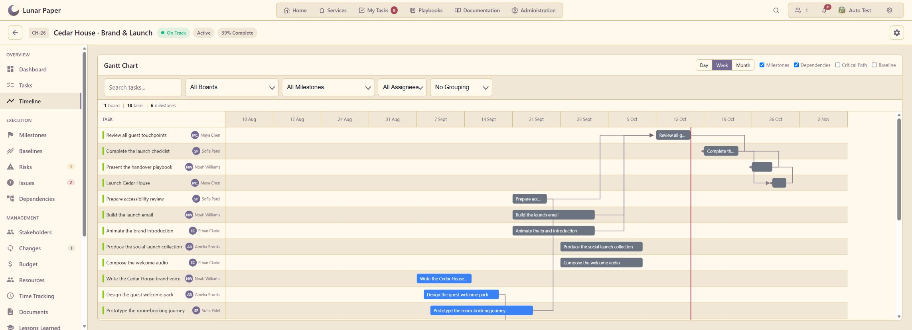

*Projects: track tasks, milestones and dependencies on a shared timeline.*

> **Free for up to three people, including after public beta.** The Moon plan
> includes every application and feature, with no time limit. Paid plans
> increase the number of people who can sign in. You provide the hosting and pay
> separately for any AI provider usage. [Compare plans](https://lunarpaper.com/pricing/).

## Explore Lunar Paper

Lunar Paper includes applications for project delivery, business processes,
reporting and creative production. Here are a few examples of what you can do.

### Plan and deliver

Build project timelines, track budgets and risks, organise tasks on boards and
plan around your team's capacity. Keep dates and availability in shared
calendars, and turn repeatable processes into visual automations with human
approvals and a record of each run.

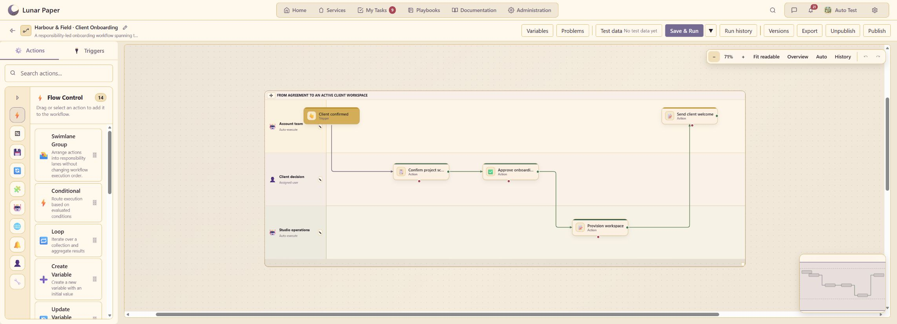

*Automation brings people, decisions and application actions into the same workflow.*

### Turn data into something useful

Collect information with Forms and store submissions in PostgreSQL. Connect
databases, files, web APIs and internal records through Data Hub, then build
dashboards and reports from reusable views. Explore results with interactive
filters, schedule delivery and export to PDF, PNG, CSV or Excel.

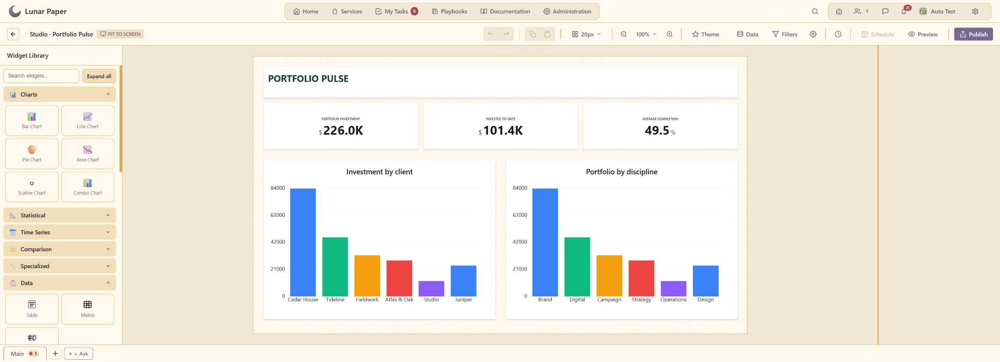

*Build a shared view of the work, from individual records to portfolio reporting.*

### Design, write and produce media

Write structured documents, map processes, build presentations and design visual
content. Use shared brand colours, typography and approved assets. Draw sprites
and animate them, record instruments and mix audio, or prepare responsive emails.
Documents can be exported to PDF, Word and Markdown.

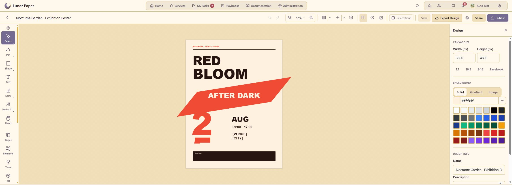

*Design Studio: create layouts with typography, vector artwork and export controls.*

Explore the creative side: Pixel Art

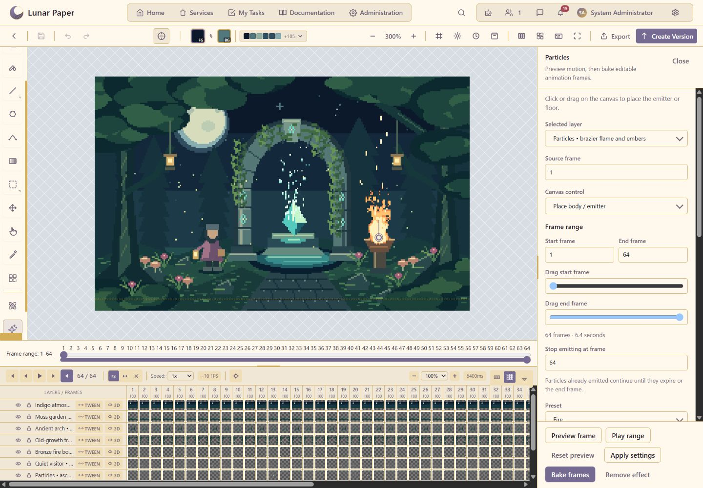

Draw sprites and tiles, work with layers and palettes, and build frame-by-frame
animation with assisted motion and export tools.

[Explore Pixel Art](https://lunarpaper.com/applications/pixel-art/) ·
[Explore Audio Creator](https://lunarpaper.com/applications/audio-creator/)

## Applications

Explore nineteen work and creative applications, plus Administration:

| Area | Applications |
| --- | --- |
| Plan and run work | [Projects](https://lunarpaper.com/applications/projects/), [Task Boards](https://lunarpaper.com/applications/task-boards/), [Resources](https://lunarpaper.com/applications/resources/), [Automation](https://lunarpaper.com/applications/automation/), [Forms](https://lunarpaper.com/applications/forms/), [Team Calendar](https://lunarpaper.com/applications/team-calendar/) |
| Connect data and report | [Data Hub](https://lunarpaper.com/applications/data-hub/), [Dashboards](https://lunarpaper.com/applications/dashboards/) |
| Develop and publish ideas | [Documents](https://lunarpaper.com/applications/documents/), [Charts and Flowcharts](https://lunarpaper.com/applications/charts-and-flowcharts/), [Slideshow](https://lunarpaper.com/applications/slideshow/), [Workspaces](https://lunarpaper.com/applications/workspace/) |
| Design and produce media | [Design Studio](https://lunarpaper.com/applications/design-studio/), [Brand Hub](https://lunarpaper.com/applications/brand-hub/), [Image Generation](https://lunarpaper.com/applications/image-generation/), [Pixel Art](https://lunarpaper.com/applications/pixel-art/), [Audio Creator](https://lunarpaper.com/applications/audio-creator/), [Asset Management](https://lunarpaper.com/applications/asset-management/) |
| Create communications | [Email Builder](https://lunarpaper.com/applications/email-builder/) |
| Manage the installation | [Administration](https://lunarpaper.com/applications/administration/) |

Across supported applications, live editing, presence, comments and notifications
help people work together. Shared libraries, version history and publishing
controls keep content connected as it develops.

[Explore the platform](https://lunarpaper.com/platform/).

## Administration and AI

People can sign in with local accounts or OIDC single sign-on, with multi-factor
authentication available. Administrators manage users, teams and roles. Each
service has its own members and permissions for viewing, editing and publishing.
Audit logs record user, automation and AI activity and can be filtered or exported
as CSV.

AI is optional. If you configure an OpenAI-compatible provider, requests go
directly from your installation to that provider using your credentials.
Administrators can set usage limits and review usage and costs. External
integrations and licence activation also need access to their respective services.

## Get started with Docker

Install Lunar Paper on a single computer or server with **Docker Compose 2.23.1
or later**. The stack includes the application, PostgreSQL, Redis and SeaweedFS
file storage, with Caddy for optional HTTPS. The documentation provides the
configuration and commands for Windows, Linux and macOS; no release ZIP is required.
You can run it on an internal network without a public domain.

Create your private environment file outside this repository, choose HTTP or
HTTPS, and follow the guide to pull a published release and start the stack.
Then open your configured browser address, unlock setup with `SETUP_KEY` and
complete first-time initialisation.

| Guide | What it covers |
| --- | --- |
| [Install Docker](https://docs.lunarpaper.com/self-hosting/install-docker/) | Docker prerequisites and platform support |
| [Install with Docker Compose](https://docs.lunarpaper.com/self-hosting/install/docker-compose/) | Configuration, startup and first-time setup on Windows, Linux and macOS |
| [Docker Compose with HTTPS](https://docs.lunarpaper.com/self-hosting/install/https/) | Encrypted access with Caddy and internal or public certificates |
| [Configuration and secrets](https://docs.lunarpaper.com/self-hosting/configuration/) | Protecting settings, credentials and encryption keys |

## Upgrading

Upgrading involves updating the Docker image, then opening web setup with your
`SETUP_KEY` to finish the update. Setup handles any database changes and activates
the release, including updates that have no database changes.

The [upgrade guide](https://docs.lunarpaper.com/self-hosting/upgrades/) covers the
steps and what to back up first. Check the
[release notes](https://github.com/lunarpaper/lunarpaper/releases) for anything
specific to the version you're installing.

- [Docker Compose upgrade steps](https://docs.lunarpaper.com/self-hosting/install/docker-compose/#upgrade)
- [HTTPS deployment upgrade steps](https://docs.lunarpaper.com/self-hosting/install/https/#upgrade)
- [Backup and restore](https://docs.lunarpaper.com/self-hosting/backup-restore/)
- [Rollback guidance](https://docs.lunarpaper.com/self-hosting/upgrades/#rollback)

Never use `docker compose down --volumes` during an upgrade. If the database has
changed, rollback requires the documented restore procedure rather than simply
switching to an older image.

## Help and feedback

- [Documentation](https://docs.lunarpaper.com/docs/) — application and administration guides.
- [Community discussions](https://github.com/lunarpaper/lunarpaper/discussions) — questions, ideas and examples of what you are building.
- [Report a bug](https://github.com/lunarpaper/lunarpaper/issues) — include the affected version and steps to reproduce it.
- [Report a security issue privately](https://github.com/lunarpaper/lunarpaper/blob/main/SECURITY.md) — follow the security policy rather than opening a public issue.

Keep credentials and customer data out of public reports.

## Licence and project

Lunar Paper is proprietary software, with a free plan for up to three active
accounts. Use is governed by the
[software licence](https://github.com/lunarpaper/lunarpaper/blob/main/LICENSE).
The public repository and container images do not grant modification or
redistribution rights.

Created in Australia by Ben Martinson, drawing on 15 years of experience with
low-code platforms, design tools, automation and data.
[About Lunar Paper](https://lunarpaper.com/about/) ·
[Licence overview](https://lunarpaper.com/licence/)

## More of Lunar Paper

### Task Boards

Track delivery through configurable columns, with owners, priorities and due dates.

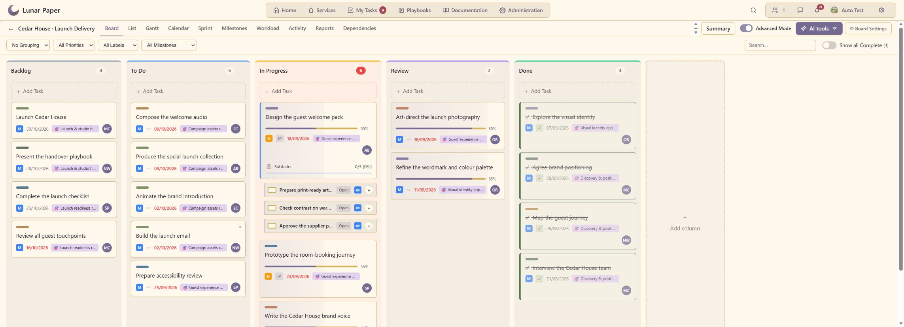

### Resources

See team skills, utilisation and weekly capacity before assigning work.

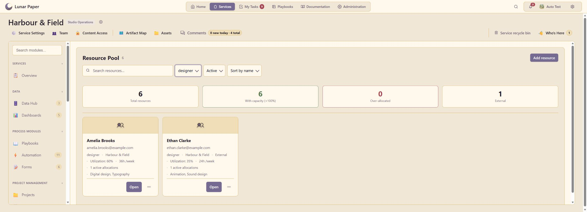

Record each person's skills, weekly hours and availability in their resource profile.

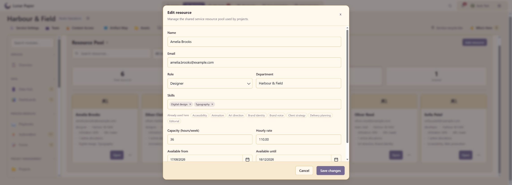

### Forms

Build forms for reviews, requests and sign-off with a visual editor.

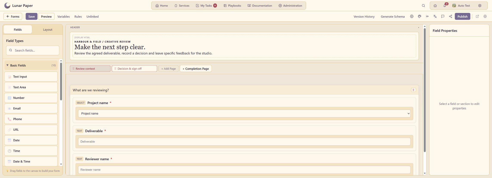

### Data Hub

Preview reusable data views with column information, filters and freshness controls.

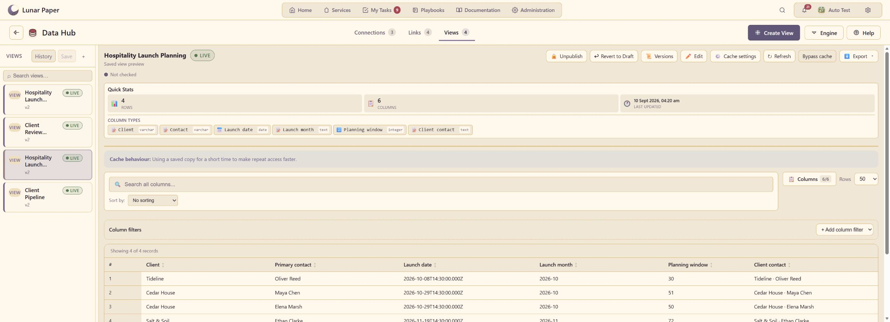

### Documents

Create structured reports using reusable content blocks.

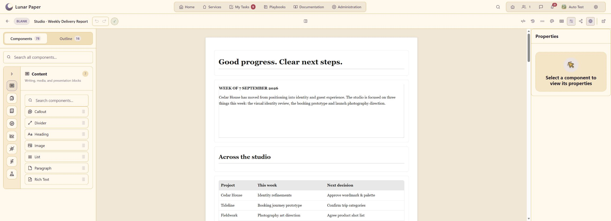

### Slideshow

Build presentations with reusable layouts, media, transitions and speaker notes.

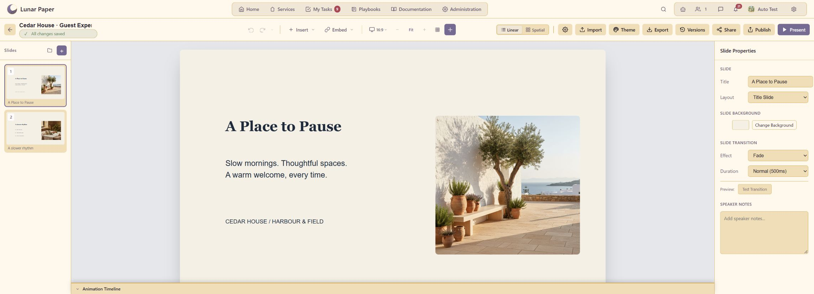

### Brand Hub

Manage logo variants, typography, colours and guidelines for a consistent identity.

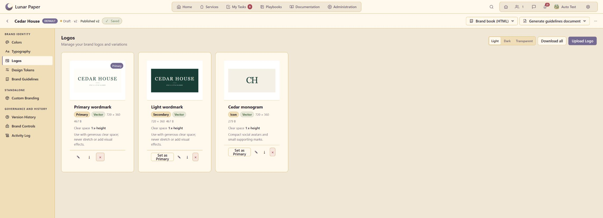

### Audio Creator

Balance instruments and recorded tracks with a multi-channel mixer.

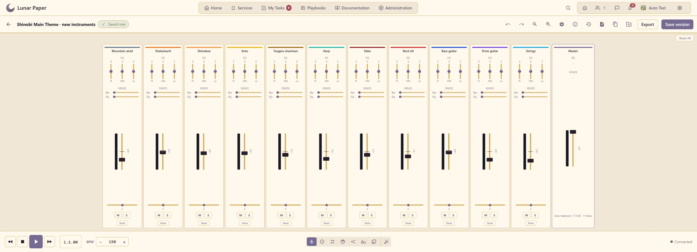

### Asset Management

Group related content into collections for campaigns and other shared work.

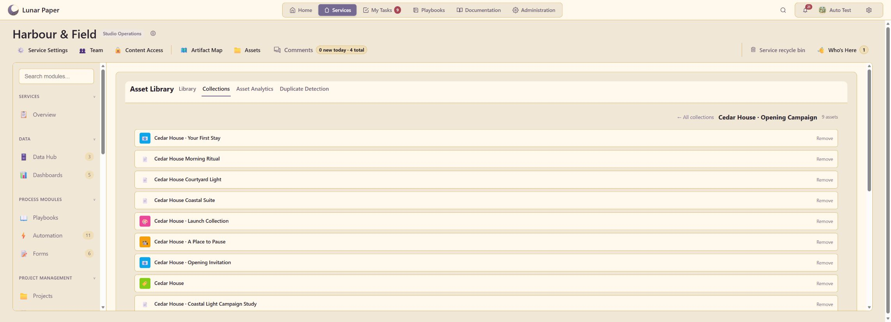

### Email Builder

Design and preview branded emails for updates and reports.

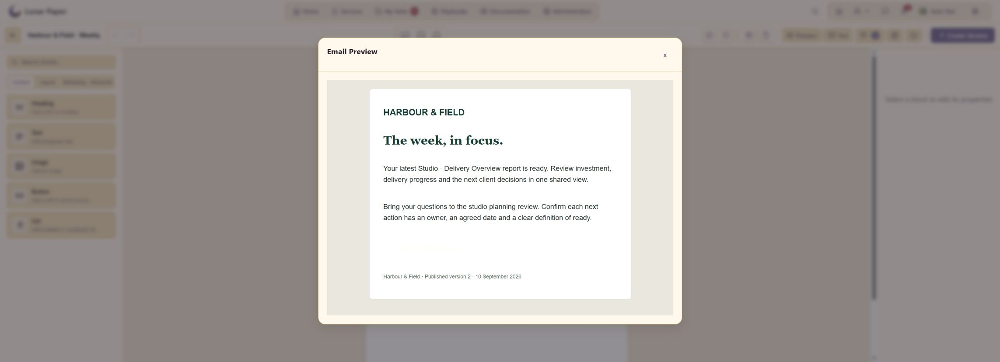

### Team Calendar

View scheduled work, client reviews and delivery dates in a shared calendar.

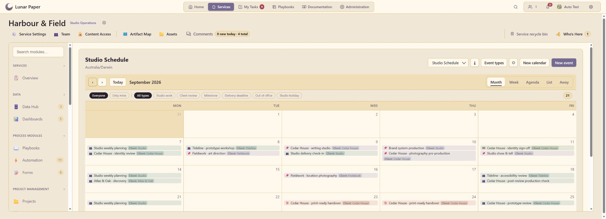

### Charts and Flowcharts

Map processes and content relationships with shapes and connectors.

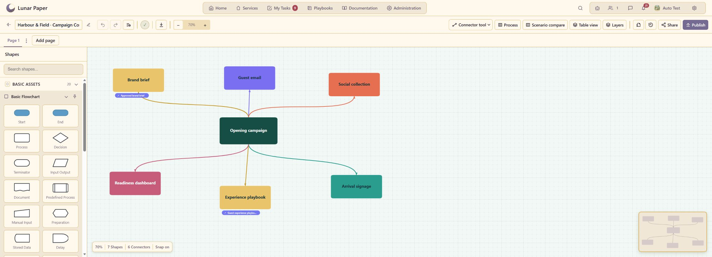

### Workspaces

Keep research and draft documents together in a project knowledge base.

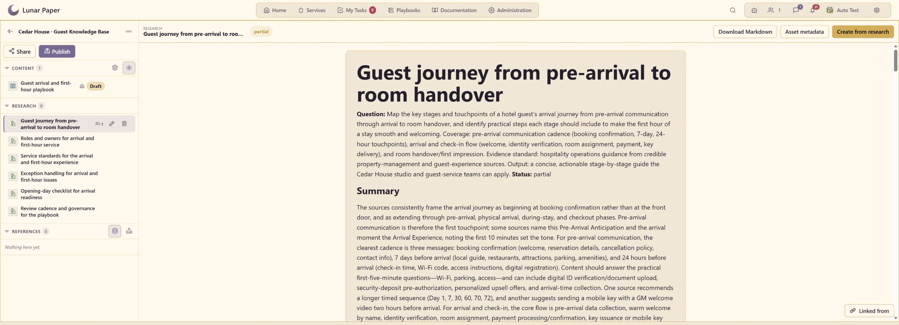

### Image Generation

Generate images and edit them with layers, selection tools and image adjustments.

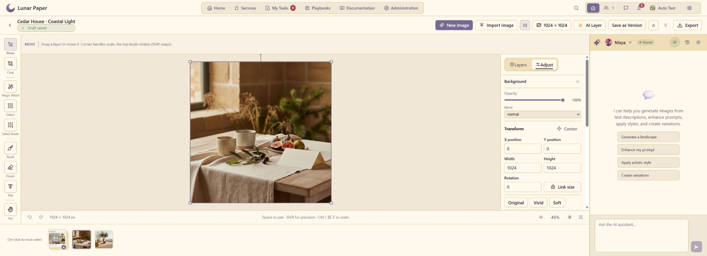
