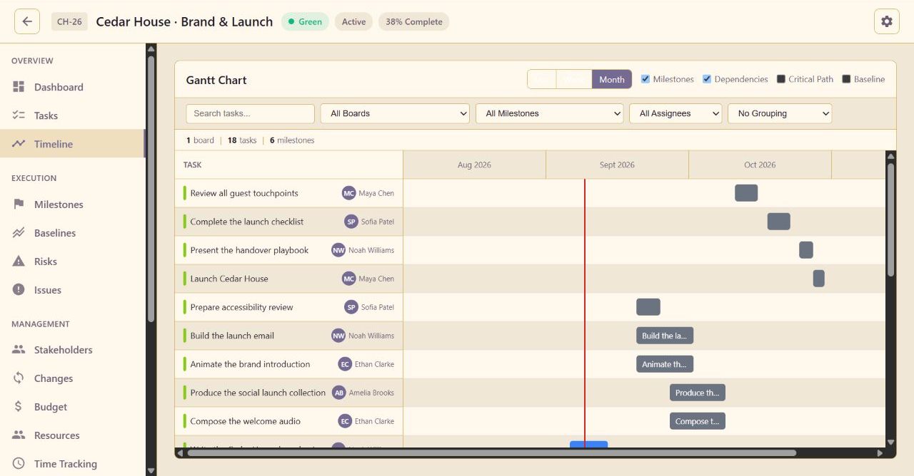
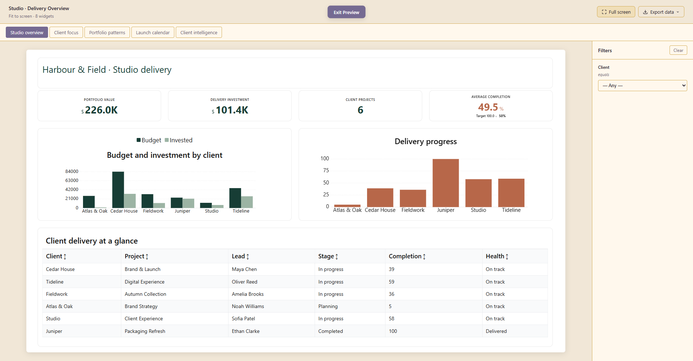
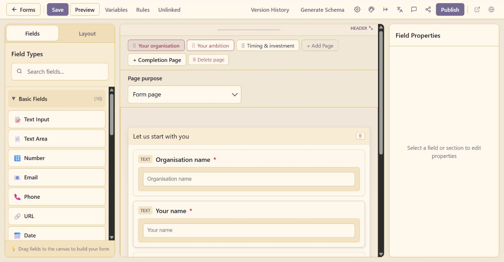
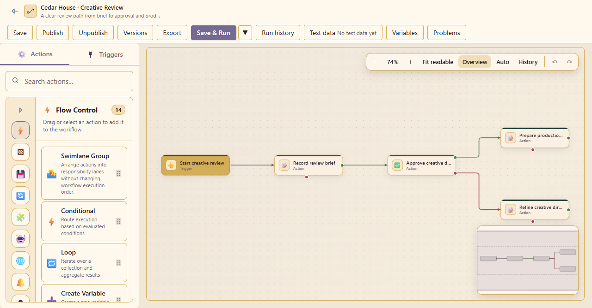
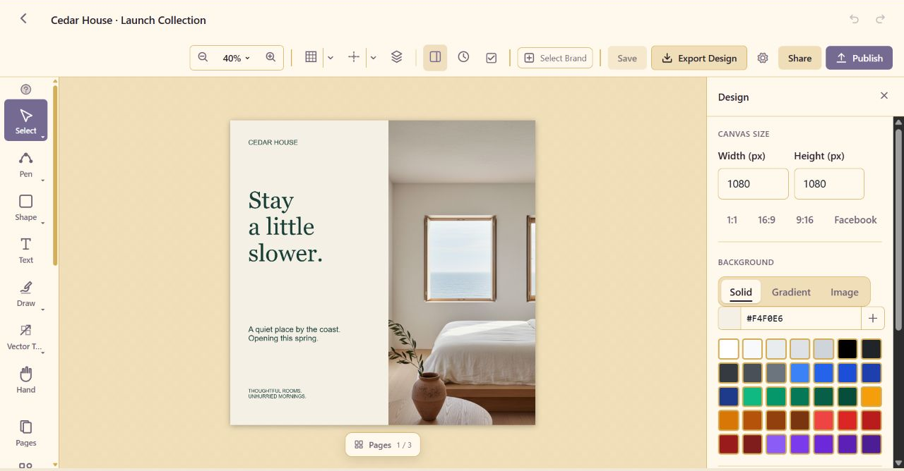

# Lunar Paper

Lunar Paper is a self-hosted platform that runs on your own computer, server or
infrastructure, keeping the platform and its data under your control.

Plan projects, manage tasks and resources, automate processes, connect and
transform data, and turn that data into dashboards and reports. Create animated
pixel art, build slideshows, produce structured documents, design visual content,
compose audio and manage the assets behind it.

Everything comes together in one platform, with live multi-user collaboration,
governance, user and access management, and a broad set of features for both the
people doing the work and the administrators running the installation.

[Explore Lunar Paper](https://lunarpaper.com/) ·
[Browse all applications](https://lunarpaper.com/applications/) ·
[Read the documentation](https://docs.lunarpaper.com/docs/) ·
[Follow the self-hosting guide](https://docs.lunarpaper.com/self-hosting/)

> **Public beta:** Use the full platform for free for three people
> with no time limit. See the [current plans](https://lunarpaper.com/pricing/) and
> [release notes](https://github.com/lunarpaper/lunarpaper/releases) for details.

### Projects

### Dashboards

### Forms

### Automation

### Design Studio

## Twenty applications, one platform

Public beta version 0.8.0 includes the following applications:

| Area | Applications |
| --- | --- |
| Planning and running work | [Projects](https://lunarpaper.com/applications/projects/), [Task Boards](https://lunarpaper.com/applications/task-boards/), [Resources](https://lunarpaper.com/applications/resources/), [Automation](https://lunarpaper.com/applications/automation/), [Forms](https://lunarpaper.com/applications/forms/) and [Team Calendar](https://lunarpaper.com/applications/team-calendar/) |
| Data and reporting | [Data Hub](https://lunarpaper.com/applications/data-hub/) and [Dashboards](https://lunarpaper.com/applications/dashboards/) |
| Documents and publishing | [Documents](https://lunarpaper.com/applications/documents/), [Charts and Flowcharts](https://lunarpaper.com/applications/charts-and-flowcharts/), [Slideshow](https://lunarpaper.com/applications/slideshow/) and [Workspaces](https://lunarpaper.com/applications/workspace/) |
| Design and media | [Design Studio](https://lunarpaper.com/applications/design-studio/), [Brand Hub](https://lunarpaper.com/applications/brand-hub/), [Image Generation](https://lunarpaper.com/applications/image-generation/), [Pixel Art](https://lunarpaper.com/applications/pixel-art/), [Audio Creator](https://lunarpaper.com/applications/audio-creator/) and [Asset Management](https://lunarpaper.com/applications/asset-management/) |
| Communications | [Email Builder](https://lunarpaper.com/applications/email-builder/) |
| Administration | [Administration](https://lunarpaper.com/applications/administration/) |

Explore the complete [applications catalogue](https://lunarpaper.com/applications/)
or read the [platform overview](https://lunarpaper.com/platform/) for more about
collaboration, governance, access control, shared libraries, optional AI and
integrations.

## Why self-host it?

- Keep the application, PostgreSQL data, file storage and backups on
  infrastructure you choose.
- Give each service its own members, branding and content while managing users,
  teams, permissions and audit activity centrally.
- Use local accounts or connect OIDC single sign-on.
- Connect an OpenAI-compatible provider with your own credentials, or leave AI
  unconfigured.
- Choose which external services the installation may reach by configuring its
  integrations and network policy.

Lunar Paper is an independent project built in Australia. Read more about the
project on the [Lunar Paper website](https://lunarpaper.com/about/).

## Get started with Docker

This repository contains the customer-facing information and the supported
single-host Docker Compose deployment bundle. Application images are published
to GitHub Container Registry as `ghcr.io/lunarpaper/platform`; large image files
are not committed to Git.

Install Docker and Docker Compose, then follow the deployment instructions for
your operating system:

- [Linux](compose/README.md#linux)
- [Windows](compose/README.md#windows)
- [macOS](compose/README.md#macos)

Each path covers downloading the release bundle, creating a private environment outside
the bundle, validating the configuration, pulling the selected release and
starting Lunar Paper. The [complete Compose guide](compose/README.md) also covers
LAN access, HTTPS, certificates, backups and upgrades.

> Download the Compose ZIP attached to the selected release. It already contains
> matching application and PostgreSQL image digests. No separate database image
> selection or initialization command is required. Repository files are templates
> used to generate that download.

## What is in this repository

| Path | Purpose |
| --- | --- |
| [`compose/`](compose/) | Single-host Docker Compose deployment for HTTP or HTTPS |
| [`compose/.env.example`](compose/.env.example) | Blank configuration template—never put real credentials in this repository |
| [`screenshots/`](screenshots/) | Full-resolution promotional product screenshots used by this README |
| [`LICENSE`](LICENSE) | Lunar Paper software licence |
| [`SECURITY.md`](SECURITY.md) | Private vulnerability-reporting guidance |

The Compose bundle runs Lunar Paper with PostgreSQL, Redis and SeaweedFS, plus
optional Caddy HTTPS termination. It is intended for a fresh, single-host
installation; it does not claim multi-node high availability or Kubernetes
support.

## Operate it safely

- Keep the populated environment file and all credentials outside the release bundle.
- Keep `SETUP_KEY`, encryption keys and database passwords stable across restarts.
- Back up PostgreSQL, Redis, uploads, the complete SeaweedFS volume, Caddy state
  and the private environment file.
- Keep `--project-name lunarpaper` and the same access-file selection on every
  Compose command so the deployment continues using the same volumes.
- Never use `docker compose down --volumes` during an upgrade.
- Review release notes and make tested backups before changing image versions.

## Help, releases and security

- [Documentation](https://docs.lunarpaper.com/docs/) — product and administration guides.
- [Self-hosting guide](https://docs.lunarpaper.com/self-hosting/docker/) — Docker deployment instructions.
- [GitHub Releases](https://github.com/lunarpaper/lunarpaper/releases) — compatible images, changes and upgrade notes.
- [Community forum](https://github.com/lunarpaper/lunarpaper/discussions) — usage questions and ideas.
- [GitHub Issues](https://github.com/lunarpaper/lunarpaper/issues) — reproducible, non-security bugs.
- [SECURITY.md](SECURITY.md) — private vulnerability-reporting instructions.

Do not post credentials, customer data or vulnerability details in a public
issue.

## Licence

Lunar Paper is proprietary software. Installing or using it means accepting the
terms in [LICENSE](LICENSE). The public availability of this repository and its
container images does not grant redistribution or modification rights. See the
[licence overview](https://lunarpaper.com/licence/) for a plain-language summary.
